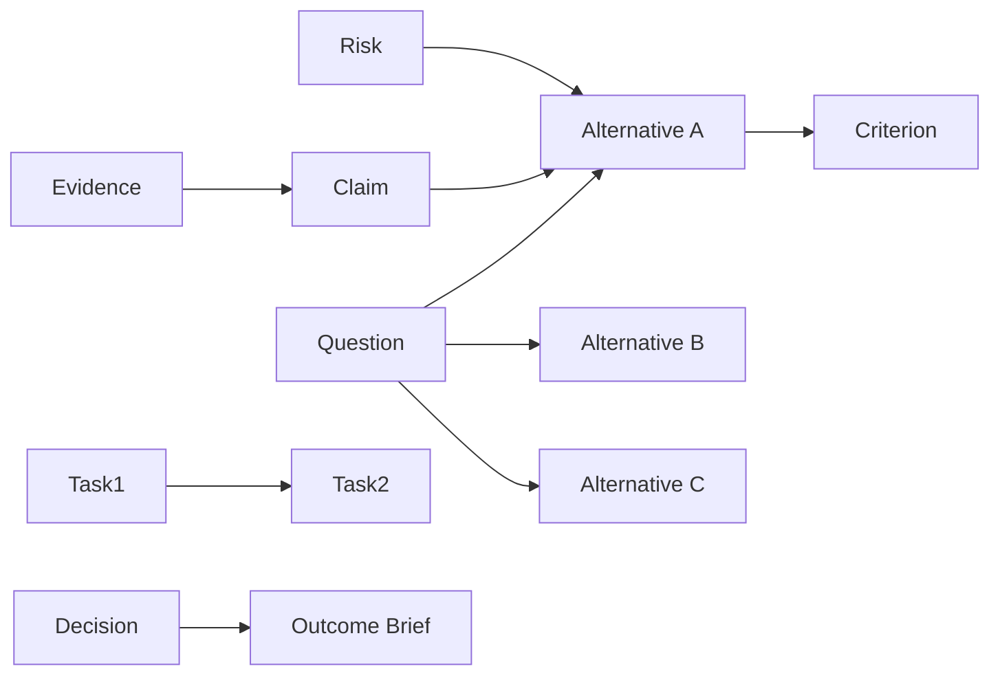
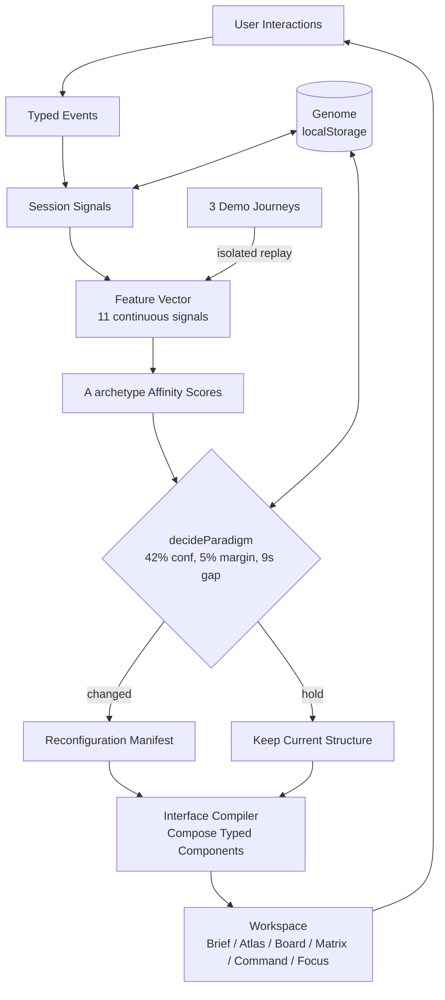

# STRATA

**An adaptive workspace — the interface should follow the work.**

STRATA is a web application that **has no fixed interface**. It watches how you work — what you open, how you compare, whether you follow dependencies or jump across the project — then rebuilds its own **navigation topology, information hierarchy, available actions, element placement and user flows** in real time.

Two people who work on the same project differently will end up navigating **structurally different versions** of the same workspace. A third visit starts from a different place again, because STRATA remembers.

> **Live:** [uchiha-madara-anuj.github.io/WEBE](https://uchiha-madara-anuj.github.io/WEBE)
> **Lab:** [uchiha-madara-anuj.github.io/WEBE/lab](https://uchiha-madara-anuj.github.io/WEBE/lab) — the Evolution Engine, inspected.
> **Source:** github.com/UCHIHA-MADARA-ANUJ/WEBE

---

## Proof, not promise

```bash
node scripts/smoke.mjs
```

Drives the real app in jsdom with three different visitors and asserts the engine restructures itself:

```
▌ READER
  PASS  reader detected — top=reader conf=0.60
  PASS  signal counter saw the opens — opens=3
  PASS  relation step detected — steps=2

▌ SKIMMER
  PASS  skimmer read as skimmer — top=skimmer conf=0.85 scan=15556
  PASS  fast scrolls registered — fast=6

▌ AUTO-RESTRUCTURING
  PASS  engine restructures without being asked — paradigm=mosaic top=skimmer conf=0.80
  PASS  reconfiguration overlay explains itself — You sweep the surface … into Mosaic
  PASS  a patient reader is moved into the reading column — paradigm=codex top=reader conf=0.66

▌ Restructuring
  PASS  manual restructure works
  PASS  mosaic tiles rendered — 31 tiles
  PASS  lattice index populated — 31 rows
```

A hurried visitor who scrolls fast and opens many entities gets a dense **Board**. A patient visitor who follows relations gets a single-column **Brief**. Nobody chose that — the engine decided, and it explains why.

---

## 1 · What the site actually is

A **fictional product-launch decision** — "determine the best way to launch a small digital product in 14 days" — modelled as a typed work graph:

- **31 entities** across 11 types: `question`, `alternative`, `claim`, `evidence`, `source`, `criterion`, `risk`, `task`, `decision`, `note`, `outcome`
- **63 typed relations**: `supports`, `contradicts`, `depends-on`, `related-to`, `evaluates`, `blocks`, `produces`
- Three launch alternatives (Lean Public / Community-First / Stealth Premium), four evaluation criteria, four risks, six tasks with real dependencies, stakeholder notes, and a draft decision brief.

> All scenario data is labelled illustrative — no fake research citations, no numbers presented as verified market facts.

Source: `src/content/strata-graph.ts`

---

## 2 · The Interface Compiler

Architecturally separate from React rendering — pure TypeScript, fully testable without a browser.

### 2.1 · Semantic work graph



Every entity has a stable `id`, `type`, `title`, `content`, `metadata`, and typed relationships. Switching presentation **never** duplicates or loses data — it is always a different way of working with the same graph.

### 2.2 · Behavioural profile — 5 dimensions

Not a personality label. Five continuous scores (0–1):

| Dimension | Signals |
|---|---|
| **Exploration** | following relations, branching, revisiting |
| **Sequential progress** | completing tasks, chaining dependencies |
| **Comparison** | inspecting alternatives, applying shared criteria |
| **Information depth** | expanding evidence, reading full explanations |
| **Synthesis** | recording decisions, creating summaries |

A user can be highly exploratory *and* highly comparative — the profile is multidimensional.

### 2.3 · Event model

```ts
type Event =
  | { kind: 'open', id: string }
  | { kind: 'edge', id: string }     // followed a typed relation
  | { kind: 'search', q: string }
  | { kind: 'filter', tag: string }
  | { kind: 'command', cmd: string }
  | { kind: 'dwell', ms: number }
  | { kind: 'scroll', px: number, v: number }
  | { kind: 'pointer', px: number }
```

Only meaningful interactions carry weight. Dwell time is ignored while the tab is hidden. No keystroke histories, no personal data.

### 2.4 · Profile update — weighted decay

```
weight(age) = 2 ^ (-age / halfLife)     // halfLife ≈ 18 meaningful events
```

1. Retrieve the event's predefined signal weights
2. Decay older observations
3. Update evidence accumulators
4. Normalise to feature vector (11 features: linearity, breadth, revisit, volume, cadence, scan, dwell, command, spatial, query, edge)
5. Calculate confidence (amount × consistency)
6. Score archetype affinity to ideal signatures

```ts
affinity(feature) = 1 − |actual − ideal| / max(ideal, 1 − ideal)
score(archetype)  = Σ weight × affinity / Σ weight
```

Six archetypes each have an **ideal signature** and **per-feature weights** (`src/engine/types.ts:ARCHETYPES`). A visitor scores high when their behaviour *resembles* that ideal — not by raw frequency mass.

### 2.5 · Composition grammar

The plan controls independently:

- Primary work surface (Brief / Atlas / Board / Matrix / Command / Focus)
- Navigation topology, relationship presentation, content grouping
- Information ordering, detail panel placement, primary action
- Suggested workflow, density, contextual tools, responsive composition

Primitives: relationship map, comparison matrix, evidence ledger, chronological sequence, dependency route, decision brief, contextual inspector, task rail, topic index, linked detail view.

These are **building blocks**, not exclusive modes. The engine can — and does — construct hybrid arrangements.

### 2.6 · Candidate scoring + constraints

Every candidate composition gets a utility score from:

- Alignment with behavioural profile
- Relevance to active task
- Suitability for semantic structure
- Context preservation
- Viewport suitability
- Switching cost

The highest unconstrained preference **does not** automatically win — accessibility, continuity, and transition cost are hard constraints. Built in `src/engine/decide.ts:decideParadigm`.

### 2.7 · Adaptation thresholds & hysteresis

- **Minimum evidence:** ~5 meaningful events before any restructuring
- **Confidence ≥ 42%** and **margin ≥ 5%** over runner-up required
- **Cooldown:** ≥ 9 seconds between automatic restructures
- **Viability gates:** each archetype must clear an evidentiary bar (e.g. Contemplative needs ≥5 s dwell; Commander needs ≥2 typed commands) — a single click cannot fake a read.
- **Switching cost & hysteresis:** ambiguous evidence keeps the current structure.

Every accepted transition produces a **readable manifest**: what changed, which signals contributed, why the composition was chosen, what was preserved.

### 2.8 · Persistent learning

Stored in `localStorage` under `strata/genome-v2` (migrated once from the previous Deep Field key):

- Behavioural profile, bounded interaction history, current composition, work graph, evolution history
- Each visit increments a **generation** counter; later generations unlock behaviour:
  - gen 2: **TRAIL** — personalised route through the graph
  - gen 3: **COMPARE** + **MEMORY** (hold two entities, remember where you left off)
  - gen 4: **CHAPTERS** — syllabus synthesised from your trail
  - gen 5+: compounding mutations (seed, ordering, relation weighting)

Controls: inspect learned profile · undo last transition · reset profile · reset demo · clear all data.

No registration, no backend, no API keys. Works offline after first load.

---

## 3 · Structural evolution — not skin-swapping

When the engine restructures, **multiple properties change together**, justified by the engine:

| Composition | What changes |
|---|---|
| **Atlas** (relationship-first) | Graph is the working surface; connected items become navigation; inspector follows the active node. |
| **Board** (density-first) | Tiles re-tile with FLIP animation; promoted entities shift position; density is the work surface. |
| **Matrix** (comparison-first) | Alternatives are first-class nav; shared criteria form the comparison structure; evidence appears in context. |
| **Sequence** (action-first) | Dependency chain is primary nav; next actionable task is visually prioritised; blockers are immediate. |
| **Brief** (evidence-first) | Single-entity column; claims/sources/relationships guide navigation; the column *is* the index. |
| **Focus** (synthesis-first) | One entity full-bleed; only "go deeper / return / let it choose". |

These are examples of **behaviours**, not four locked modes. The engine combines properties from multiple tendencies.

---

## 4 · The Evolution Lab

Essential for judges — accessible at `/lab`:

- **Live telemetry:** actual behavioural scores, active features, current plan, recent decisions, accepted/rejected candidates, honest reasons.
- **Three reproducible journeys:** Explorer (relation-hopping), Executor (task-chaining), Analyst (criteria-comparing) — each run through the *same* `classify()` + `decideParadigm()` pipeline with isolated profiles. Different outcomes because different evidence, not predetermined layouts.
- **Step-by-step replay:** each event and the engine's decision at that moment.
- **Side-by-side comparison:** same starting graph, three different final compositions.

```bash
# The engine diverges — run programmatically:
# See src/lib/replay/journey-fixtures.ts + src/lib/replay/replay-engine.ts
```

---

## 5 · Product workspace

- Product wordmark (STRATA, stratified rule undertype) + compact top nav
- Mission context always visible
- Dynamically composed primary workspace + contextual detail area
- Real actions: inspect, traverse relations, expand evidence, compare, complete tasks, record decision, create brief, undo evolution, replay journeys, reset profile.
- Cold start is balanced and readable; adaptation becomes more pronounced with evidence.

**Continuity:** active entity survives transitions; unsaved input is preserved; keyboard focus is sensible; transition notice is human-readable; no silent data loss.

---

## 6 · Visual identity

Warm editorial — not a generic AI dashboard.

- **Surfaces:** warm off-white paper (`#FDF8F0`), near-black ink (`#0A0A0A`), stone neutrals, vermilion accent (`#DC2626`) for change, secondary blue/green by semantic role.
- **Typography:** editorial serif (Newsreader) for large statements, modern sans (Space Grotesk) for UI, monospace (JetBrains Mono) for metadata/IDs.
- **Layout:** precise grids, asymmetric disciplined whitespace, thin structural rules, restrained radii.

Forbidden and avoided: purple-blue gradients, glassmorphism, glowing orbs, emoji nav, floating particles, unnecessary 3D, template SaaS chrome.

---

## 7 · Animation — each library has a distinct job

| Library | Responsibility |
|---|---|
| **Motion** (`motion/react`) | Structural layout transitions, `layout` / `layoutId` continuity, presence/exit, hierarchy reassembly |
| **Lenis** | Progressive enhancement for outer-document scrolling only — never inside work surfaces. Respects `prefers-reduced-motion`. |
| **GSAP + ScrollTrigger** (`gsap`, `@gsap/react`) | One editorial scroll-linked diagram (the Interface Compiler explainer). React integration with proper cleanup. Not used to animate every card. |
| **Anime.js v4** (`animejs`) | STRATA identity mark — staggered stratification line draw. One job, module API. |

No library animates the same property on the same element. Durations restrained: 180–450 ms for workspace transitions, slightly longer for full reorganisation. Works without any animation; `prefers-reduced-motion` disables decorative motion.

---

## 8 · Stack

- **App:** Next.js 16 App Router (static export), React 19, TypeScript (strict), Tailwind via CSS custom properties, `lucide-react` icons
- **State:** React Context + `localStorage` (Zustand-compatible store pattern)
- **Validation:** Zod for persisted genome schemas
- **Animation:** `motion` + `lenis` + `gsap`/`@gsap/react` + `animejs`
- **Graph:** `@xyflow/react` for the Atlas, `@dagrejs/dagre` for auto-layout
- **Testing:** Vitest, React Testing Library, Playwright (via Puppeteer for smoke)
- **Build:** Next.js static export → `dist/` (GH Pages), Vite fallback preserved for smoke harness

```
src/
  content/
    strata-graph.ts              31 entities, 63 relations — the demo scenario
    deepfield-graph.ts           previous cosmos corpus (preserved, not active)
    graph.ts                     shim: graph -> strata-graph
  engine/
    types.ts                     paradigms, archetypes, features, genome types
    classify.ts                  raw trace → feature vector → archetype scores
    decide.ts                    archetype → paradigm, trail, chapters, manifests
    genome.ts                    persistence, generations, interest model
    store.tsx                    live engine: observe → decide → restructure
  lib/
    replay/
      journey-fixtures.ts        three reproducible demo journeys
      replay-engine.ts           real scoring pipeline for isolated replays
  components/
    identity/StrataMark.tsx      Anime.js wordmark
    identity/StrataBackdrop.tsx   warm paper texture + seeded flecks
    motion/LenisProvider.tsx      progressive scroll enhancement
    motion/StructuralTransition.tsx Motion layout reassembly
    evolution/EvolutionLabPanel.tsx, JourneyReplay.tsx, JourneyComparison.tsx
    editorial/StrataExplainer.tsx GSAP editorial diagram
    Chrome.tsx, MindPanel.tsx, StatusBar.tsx, Reconfigure.tsx
  modes/
    Codex.tsx → Brief             Lattice.tsx → Matrix
    Constellation.tsx → Atlas    Console.tsx → Command
    Mosaic.tsx → Board            Zen.tsx → Focus
  app/
    layout.tsx, page.tsx, lab/page.tsx
    globals.css, modes.css
```

---

## 9 · Performance & reliability

- Heavy surfaces lazy-loaded where not initially visible
- Animation libs code-split — not shipped to pages that don't use them
- React re-renders batched via tick coalescing; persistence debounced
- Event history bounded & documented
- Malformed/outdated `localStorage` handled safely (migration from deep field key)
- No hydration mismatches; `suppressHydrationWarning` only where seeded grain is intentional
- Zero console errors in normal use
- Works offline after initial asset load

---

## 10 · Running it

```bash
npm install

npm run dev          # http://localhost:5173 — Next.js dev (Turbopack)
npm run build        # Next.js static export → dist/
npm run build:vite   # Vite fallback (for smoke harness compat)
npm run typecheck    # tsc --noEmit

node scripts/smoke.mjs       # 30 headless assertions against the real app
# node scripts/live-check.mjs  (built-site browser assertions — see below)
```

### Tests

**Engine tests (headless, no browser):**
```
node scripts/smoke.mjs — mounts the real app in jsdom and plays three visitors
  · reader: opens + follows relations → classified as reader
  · skimmer: fast scrolls + many opens → classified as skimmer, restructures to Board
  · analyst: filters + queries → comparison signals
  · auto-restructuring: skimmer→Board, reader→Brief, with explained manifests
  · all six paradigms render, generations unlock, Mind panel reports honestly
```

**Browser-level tests (Playwright where available):**
- Complete a task, compare alternatives, trigger adaptation, undo, refresh+restore, run a journey, keyboard nav, mobile usability.

---

## 11 · Architecture diagram



---

## 12 · Key design decisions

| Decision | Choice | Why |
|---|---|---|
| **Framework** | Next.js 16 App Router, static export | Spec-faithful; static export works for GH Pages; Vite path alias preserved for tooling |
| **Styling** | CSS custom properties, no UI library | Prevents generic template look; warm editorial tokens are first-class |
| **State** | React Context + localStorage (Zustand-pattern) | Minimal deps; engine stays pure TS; no backend |
| **Animation split** | Motion = layout, Lenis = scroll, GSAP = editorial, Anime = identity | Each library has one job; no duplicated effects |
| **Persistence** | `strata/genome-v2` with legacy migration | Clean break from Deep Field while preserving returning-visitor demo |
| **Paradigm IDs** | Engine IDs stable (`codex` etc), display names remapped | Persistence doesn't break; judges see STRATA vocabulary |

---

## 13 · Known limitations

- **No cross-device sync** — persistence is `localStorage` scoped to browser + origin (documented in README + Mind panel).
- **No server** — the demo cannot show multi-user convergence/divergence server-side; simulated journeys prove the algorithm instead.
- **No real analytics** — intended; the engine is deterministic and inspectable locally.
- **Smoke harness uses esbuild+jsdom** — not a full browser engine; `live-check.mjs` (Puppeteer) covers real-browser assertions when Chromium is available.

---

## 14 · Deliverables mapping

| Required | Location |
|---|---|
| Live link | github.io/WEBE (`dist/` export) + `dist/.nojekyll` |
| Source | this repository, branch `arena/8557b219-webe` |
| README with Engine explanation | this file (§2) + Mermaid diagram |
| Evolution Lab accessible from main UI | header **Lab** button → `/lab` (Telemetry / Replay / Compare) |
| Persistent learning, reset, undo | Mind panel + Chrome gen badge + Status bar |
| Different users → different structures | `scripts/smoke.mjs` auto-restructuring + `/lab` comparison |
| Explanation of every transform | Reconfigure manifest (headline + layout + verbs + promoted + reasons) |

---

*Built for the Impossible Interface challenge — not to demo theming, but to demonstrate that a website can learn how a person works and rebuild itself around that evidence, without surrendering usability.*
