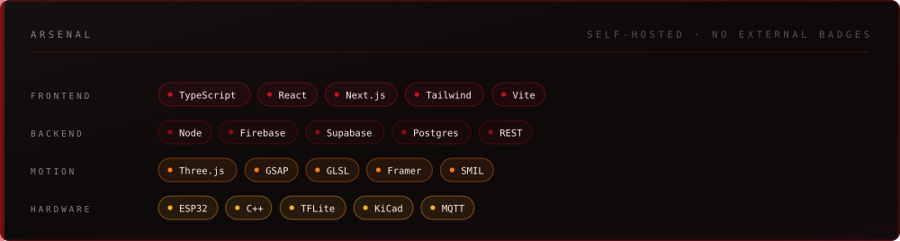

<!-- ═══════════════════════════════════════════════════════════════════════
     MADARA — profile README
     -------------------------------------------------------------------
     BEFORE YOU COMMIT, replace:
        YOUR_USERNAME   → your new GitHub handle
        YOUR_EMAIL      → your email
     Keep all four .svg files next to this README in the repo root.

     Assets: banner.svg · evolution.svg · bingo.svg · stats.svg
             arsenal.svg · seal.svg · sharingan.svg · divider.svg
             typing.svg
     ═══════════════════════════════════════════════════════════════════════ -->

  

 

  

  

<h1 align="center">ANUJ PHULERA</h1>

  <code>UCHIHA CLAN</code> &nbsp;·&nbsp;
  <code>INTERFACE ENGINEER</code> &nbsp;·&nbsp;
  <code>JAIPUR, INDIA</code>

  <a href="#-the-path"><b>The Path</b></a> &nbsp;·&nbsp;
  <a href="#-selected-work"><b>Work</b></a> &nbsp;·&nbsp;
  <a href="https://uchiha-madara-anuj.github.io/WEBE"><b>Live Site</b></a> &nbsp;·&nbsp;
  <a href="mailto:YOUR_EMAIL"><b>Email</b></a>

 

  

## ⦿ The Eye

I build **interfaces that rebuild themselves around the person using them.**

Most websites show everyone the same page. Mine watch how you move — where you
linger, what you skip, how fast you read — then restructure their own layout,
hierarchy and navigation to match. Two people leave a completely different
website behind. The engine explains every change it makes, and never makes one
it can't justify.

> *That is not a random shuffle. That is a decision.*

## ⦿ Right Now

| | |
|---|---|
| 🔴 **Building** | **DEEP FIELD** — a living atlas of the cosmos with no fixed interface. Six structural paradigms, eleven live behavioural signals, and an engine that earns the right to rearrange the page. |
| 🩸 **Growing** | **VERDE** — a vertical farm that waters itself. ESP32 firmware, TensorFlow Lite disease classifier, custom PCB, Hindi/English control channel. |
| 🗡 **Shipping** | **COMMITQUEST** — reads any GitHub profile like a scorecard and hands you quests to fix what's missing. |

## ⦿ Selected Work

<table>
<tr>
<td width="50%" valign="top">

###  [DEEP FIELD](https://github.com/YOUR_USERNAME/WEBE)
A cosmos atlas that reorganises its own layout and navigation model per visitor — and explains every decision in plain language.

`React 19` `Vite` `TypeScript` `SMIL`

</td>
<td width="50%" valign="top">

###  [VERDE OS](https://github.com/YOUR_USERNAME/VERDE-CBSE-APP)
Mission control for an autonomous vertical farm. Live ESP32 telemetry, AI plant doctor, every key server-side behind whitelisted routes.

`Next 16` `TypeScript` `Firebase` `Gemini`

</td>
</tr>
<tr>
<td width="50%" valign="top">

###  [NIRMAN](https://github.com/YOUR_USERNAME/nirmaan-app)
An AI-powered e-waste pickup network for India. Three role dashboards, live routing, end-to-end bookings.

`Next 14` `Firebase` `Supabase` `Leaflet`

</td>
<td width="50%" valign="top">

###  [SKILLVERSE](https://github.com/YOUR_USERNAME/S2S)
Turns screen time into skill time. 34 routes, 8 AI pipelines, a 250-respondent research dataset.

`Next 14` `Gemini` `Postgres`

</td>
</tr>
<tr>
<td width="50%" valign="top">

###  [COMMITQUEST](https://github.com/YOUR_USERNAME/Commit)
Scores the balance of your contribution types and hands you quests to unlock the rest. Zero dependencies, 53 assertions.

`Vanilla JS` `GitHub API`

</td>
<td width="50%" valign="top">

###  [RESONATE](https://github.com/YOUR_USERNAME/Resonate-Portfolio)
A cinematic platform about algorithmic empathy. Custom GLSL shaders, ~25 pages of scroll-driven narrative.

`React 19` `Three.js` `GSAP`

</td>
</tr>
</table>

<b>&nbsp;⚔ Three more, if you're curious</b>

 

** [PROJECT VIKAS](https://github.com/YOUR_USERNAME/Asset-Manager-Vikas)** — a cinematic exhibition on green technology in India. Tricolour design system, GSAP scroll control, full monorepo with an Express API.
 Built with Aarav Choudhary.

** [OBSIDIAN](https://github.com/YOUR_USERNAME/Dayum)** — a classified Imperial command portal. Nine modules, a 62-second promo film, and 3D renders from a raytracer I wrote myself.

** [ek-hi-chaand](https://github.com/YOUR_USERNAME/Rakshbandhan)** — a ten-chapter Raksha Bandhan site for my sister. Gurugram to Pune, 1,450 km, custom audio engine.

## ⦿ The Path

Interfaces that change shape are easy to make **unusable**. Anyone can shuffle a
grid. The hard part was never the shuffling.

> **The hard part is earning the right to shuffle.**

So DEEP FIELD only reconstructs itself when the engine has **evidence** — a
confident read, and a clear margin over the runner-up — and never more than once
every nine seconds. It shows you what changed and why. It lets you pin a
structure and switch the engine off. It never loses your place.

Every project here is an argument for the same idea: *adapt, but never at the
cost of trust.*

## ⦿ Attribute Sheet

  

## ⦿ Arsenal

  

  

*“Wake up to reality. Nothing ever goes as planned in this world.”*

 

<b>— Madara Uchiha</b> · and also every deploy I've ever done at 2 a.m.

  

Jaipur, India · building things that shouldn't fit in a browser tab

  

<a href="https://github.com/YOUR_USERNAME?tab=repositories"><b>Repositories</b></a> &nbsp;·&nbsp;
<a href="https://uchiha-madara-anuj.github.io/WEBE"><b>DEEP FIELD</b></a> &nbsp;·&nbsp;
<a href="mailto:YOUR_EMAIL"><b>Email</b></a>

