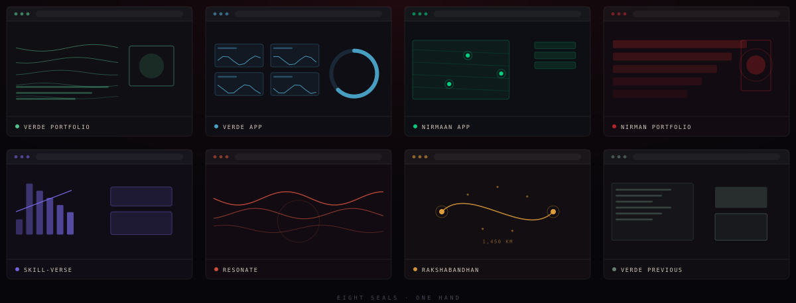

<!-- ═══════════════════════════════════════════════════════════════════════
     ANUJ PHULERA — profile README
     github.com/Anuj-Phulera
     -------------------------------------------------------------------
     Nothing left to replace — details are live.

     Keep every .svg next to this README in the repo root.
     Used here: opening.svg · registry.svg · emblem.svg · projects.svg
                stats.svg · divider.svg · credits.svg
     (banner.svg, banner-light.svg and typing.svg ship in the zip as
      spares — this README does not reference them)
     ═══════════════════════════════════════════════════════════════════════ -->

<div align="center">
  
</div>

<br/>

<div align="center">
  
</div>

<h1 align="center">ANUJ PHULERA</h1>

<p align="center">
  <code>SEALING CORPS</code> &nbsp;·&nbsp;
  <code>INTERFACE ENGINEER</code> &nbsp;·&nbsp;
  <code>GURUGRAM, INDIA</code>
</p>

<p align="center">
  <a href="#-selected-work"><b>Work</b></a> &nbsp;·&nbsp;
  <a href="#-the-path"><b>The Path</b></a> &nbsp;·&nbsp;
  <a href="https://github.com/Anuj-Phulera/WEBE"><b>Live Site</b></a> &nbsp;·&nbsp;
  <a href="mailto:anuj.phulera.work@gmail.com"><b>Email</b></a> &nbsp;·&nbsp;
  <a href="https://discord.com/users/1417462466304016494"><b>Discord</b></a>
</p>

<br/>

<div align="center">
  
</div>


## ⦿ The Seal

**I don't chase attention. I build things that command it.**

Every project here starts from the same belief: software should adapt to the
person using it, not the other way round. Not a theme switcher — the structure.
The layout, the hierarchy, what's available and what's hidden, decided at
runtime by watching how you actually read.

> *A random shuffle is noise. A decided one is a signal.*


## ⦿ Right Now

<div align="center">
  
</div>

**DEEP FIELD** is a living atlas of the cosmos with no fixed interface. **VERDE** is a
vertical farm that waters itself. **NIRMAAN** is an AI-powered e-waste pickup network
for India — three roles, live routing, bookings that run end to end.


## ⦿ Selected Work

<div align="center">
  
</div>

<map name="works">
  <area shape="rect" coords="10,10,290,206"  href="https://github.com/Anuj-Phulera/Verde-Portfolio" alt="Verde Portfolio" />
  <area shape="rect" coords="310,10,590,206" href="https://github.com/Anuj-Phulera/Verde-APP" alt="Verde App" />
  <area shape="rect" coords="610,10,890,206" href="https://github.com/Anuj-Phulera/Nirmaan-APP" alt="Nirmaan App" />
  <area shape="rect" coords="910,10,1190,206" href="https://github.com/Anuj-Phulera/NIrman-Portfolio" alt="Nirman Portfolio" />
  <area shape="rect" coords="10,226,290,422" href="https://github.com/Anuj-Phulera/Skill-Verse" alt="Skill-Verse" />
  <area shape="rect" coords="310,226,590,422" href="https://github.com/Anuj-Phulera/Resonate" alt="Resonate" />
  <area shape="rect" coords="610,226,890,422" href="https://github.com/Anuj-Phulera/Rakshabandhan" alt="Rakshabandhan" />
  <area shape="rect" coords="910,226,1190,422" href="https://github.com/Anuj-Phulera/Verde-Previous-Portfolio" alt="Verde Previous Portfolio" />
</map>

| | | |
|---|---|---|
| **[VERDE PORTFOLIO](https://github.com/Anuj-Phulera/Verde-Portfolio)**<br/><sub>closed-loop farm compendium</sub> | **[VERDE APP](https://github.com/Anuj-Phulera/Verde-APP)**<br/><sub>live telemetry mission control</sub> | **[NIRMAAN APP](https://github.com/Anuj-Phulera/Nirmaan-APP)**<br/><sub>e-waste pickup network</sub> |
| **[NIRMAN PORTFOLIO](https://github.com/Anuj-Phulera/NIrman-Portfolio)**<br/><sub>sixteen-act narrative</sub> | **[SKILL-VERSE](https://github.com/Anuj-Phulera/Skill-Verse)**<br/><sub>skill analytics platform</sub> | **[RESONATE](https://github.com/Anuj-Phulera/Resonate)**<br/><sub>algorithmic empathy</sub> |
| **[RAKSHABANDHAN](https://github.com/Anuj-Phulera/Rakshabandhan)**<br/><sub>1,450 km, one thread</sub> | **[VERDE PREVIOUS](https://github.com/Anuj-Phulera/Verde-Previous-Portfolio)**<br/><sub>the original build</sub> | <sub>&nbsp;</sub> |


## ⦿ The Path

Interfaces that change shape are easy to make **unusable**. Anyone can shuffle a
grid. The hard part was never the shuffling.

> **The hard part is earning the right to shuffle.**

So DEEP FIELD only reconstructs itself when the engine has **evidence** — a
confident read, and a clear margin over the runner-up — and never more than once
every nine seconds. It shows you what changed and why. It lets you pin a
structure and switch the engine off. It never loses your place.

Every project here is an argument for the same idea: *adapt, but never at the
cost of trust.*


## ⦿ Attribute Sheet

<div align="center">
  
</div>


## ⦿ Run It

Every repo here runs with the same three commands. No build servers, no Docker, no ceremony.

```bash
npm install
cp .env.example .env.local    # VERDE APP and NIRMAAN APP only
npm run dev                   # → http://localhost:3000
```

DEEP FIELD and CommitQuest need nothing at all — one is Vite, the other is plain
files you can open directly.


## ⦿ Contact

Open an issue on any repo, or reach me directly — I answer both.

<p>
  <a href="mailto:anuj.phulera.work@gmail.com"></a>
  <a href="https://discord.com/users/1417462466304016494"></a>
</p>


<div align="center">


<br/>



</div>

<br/>

<div align="center">

<a href="https://github.com/Anuj-Phulera?tab=repositories"><b>Repositories</b></a> &nbsp;·&nbsp;
<a href="https://github.com/Anuj-Phulera/WEBE"><b>DEEP FIELD</b></a> &nbsp;·&nbsp;
<a href="mailto:anuj.phulera.work@gmail.com"><b>Email</b></a> &nbsp;·&nbsp;
<a href="https://discord.com/users/1417462466304016494"><b>Discord</b></a>

</div>
