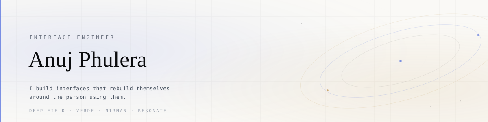

<!-- ═══════════════════════════════════════════════════════════════════
     Replace before committing:
       YOUR_USERNAME  →  your new GitHub handle
       YOUR_EMAIL     →  your email
     Everything else is ready.
     ═══════════════════════════════════════════════════════════════════ -->

  <picture>
    <source media="(prefers-color-scheme: dark)" srcset="./banner-dark.svg">
    <source media="(prefers-color-scheme: light)" srcset="./banner-light.svg">
    
  </picture>

<h1 align="center">Hi, I'm Anuj.</h1>

  <b>I build interfaces that rebuild themselves around the person using them.</b>

  
    Most websites show everyone the same page. Mine watch how you move — where you linger,
    what you skip, how fast you read — then restructure their own layout, hierarchy and
    navigation to match. Two people leave a different website behind.
  

  <a href="#-selected-work"><b>Work</b></a> &nbsp;·&nbsp;
  <a href="https://uchiha-madara-anuj.github.io/WEBE"><b>Live demo</b></a> &nbsp;·&nbsp;
  <a href="mailto:YOUR_EMAIL"><b>Email</b></a>

---

### ◈ Right now

- 🔭 **Building** &nbsp; DEEP FIELD — a cosmos atlas with no fixed interface. Six structural paradigms, eleven live behavioural signals, and an engine that explains every decision it makes.
- 🌱 **Growing** &nbsp; VERDE — a vertical farm that waters itself. ESP32 firmware, a TensorFlow Lite disease classifier, and a custom PCB.
- ⚡ **Shipping** &nbsp; CommitQuest — reads any GitHub profile like a scorecard and hands you quests to fix what's missing.

---

### ◈ Selected work

<table>
<tr>
<td width="50%" valign="top">

#### [DEEP FIELD](https://github.com/YOUR_USERNAME/WEBE)
A living atlas of the cosmos whose layout, hierarchy and navigation model are rebuilt at runtime around each visitor's behaviour — and which explains every change in plain English.

`React 19` `Vite` `TypeScript`

</td>
<td width="50%" valign="top">

#### [VERDE OS](https://github.com/YOUR_USERNAME/VERDE-CBSE-APP)
Mission control for an autonomous vertical farm. Live ESP32 telemetry, an AI plant doctor, and every API key kept server-side behind five whitelisted routes.

`Next 16` `TypeScript` `Firebase`

</td>
</tr>
<tr>
<td width="50%" valign="top">

#### [NIRMAN](https://github.com/YOUR_USERNAME/nirmaan-app)
An AI-powered e-waste pickup network for India. Three role dashboards, live routing, and a booking pipeline that runs end to end.

`Next 14` `Firebase` `Supabase` `Leaflet`

</td>
<td width="50%" valign="top">

#### [SKILLVERSE](https://github.com/YOUR_USERNAME/S2S)
Turns screen time into skill time. Thirty-four routes, eight AI analysis pipelines, and a 250-respondent research dataset behind every product claim.

`Next 14` `Gemini` `Postgres`

</td>
</tr>
<tr>
<td width="50%" valign="top">

#### [COMMITQUEST](https://github.com/YOUR_USERNAME/Commit)
Scans a GitHub profile, scores the balance of your contribution types, and hands you quests to unlock whatever's missing. Zero dependencies, 53 assertions.

`Vanilla JS` `GitHub API`

</td>
<td width="50%" valign="top">

#### [RESONATE](https://github.com/YOUR_USERNAME/Resonate-Portfolio)
A cinematic platform about algorithmic empathy. Custom GLSL shaders, ~25 pages of scroll-driven narrative.

`React 19` `Three.js` `GSAP`

</td>
</tr>
</table>

<b>&nbsp;Three more, if you're curious</b>

 

- **[PROJECT VIKAS](https://github.com/YOUR_USERNAME/Asset-Manager-Vikas)** — a cinematic exhibition on green technology in India. Tricolour design system, GSAP scroll control, full monorepo with an Express API. Built with Aarav Choudhary.
- **[OBSIDIAN](https://github.com/YOUR_USERNAME/Dayum)** — a classified Imperial command portal: nine modules, a 62-second promo film, and 3D renders produced by a raytracer I wrote in Python.
- **[ek-hi-chaand](https://github.com/YOUR_USERNAME/Rakshbandhan)** — a ten-chapter Raksha Bandhan site for my sister. Gurugram to Pune, 1,450 km, a custom audio engine, and a rakhi you tie by holding a button.

---

### ◈ What I actually spend my time on

Interfaces that change shape are easy to make unusable. The interesting problem isn't the reshuffling — it's earning the right to reshuffle.

So DEEP FIELD only reconstructs itself when the engine has **evidence** (a confident read, a clear margin over the runner-up) and never more than once every nine seconds. It shows you what changed and why. It lets you pin a structure and switch the engine off. And it never loses your place.

That constraint — *adapt, but never at the cost of trust* — is the thing I care about. Everything I build is an argument for it.

---

### ◈ The stack

  
  
  
  
  
   
  
  
  
  
  

---

  Jaipur, India &nbsp;·&nbsp; building things that shouldn't fit in a browser tab

