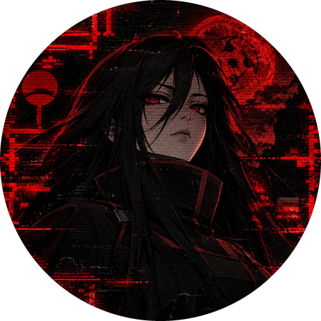
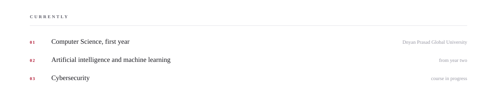

<!--
  Mitali Chincholikar · GitHub profile README

  Upload this file, the five panel pairs and avatar.png to the root of her
  profile repository. Nothing else is required.

  Every panel ships as light and dark and is switched with <picture>, so the
  profile is correct in both themes instead of relying on one of them.
  There is no animation anywhere in this kit, by design.
-->

  

<picture>
  <source media="(prefers-color-scheme: dark)" srcset="./header-dark.svg" />
  
</picture>

<picture>
  <source media="(prefers-color-scheme: dark)" srcset="./focus-dark.svg" />
  
</picture>

<picture>
  <source media="(prefers-color-scheme: dark)" srcset="./stack-dark.svg" />
  
</picture>

<a href="mailto:chincholikarmitali@gmail.com">
  <picture>
    <source media="(prefers-color-scheme: dark)" srcset="./contact-dark.svg" />
    
  </picture>
</a>

<picture>
  <source media="(prefers-color-scheme: dark)" srcset="./divider-dark.svg" />
  
</picture>

  Pune, Maharashtra, India

