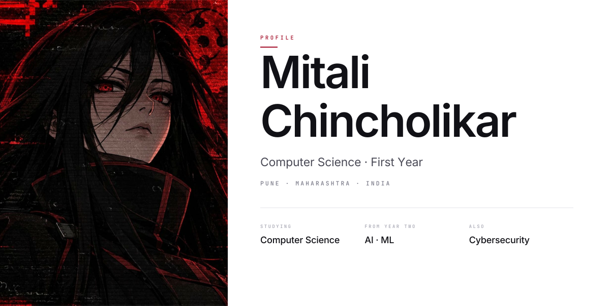
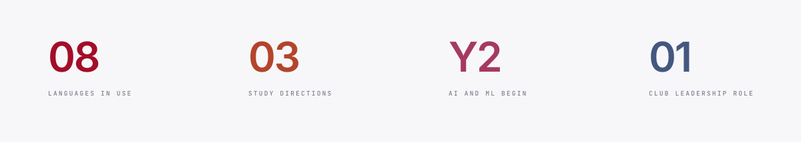
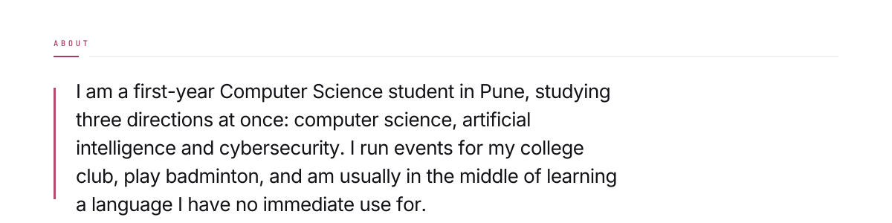
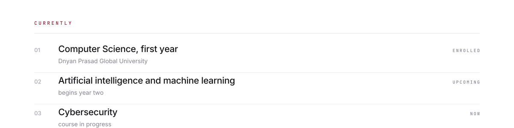
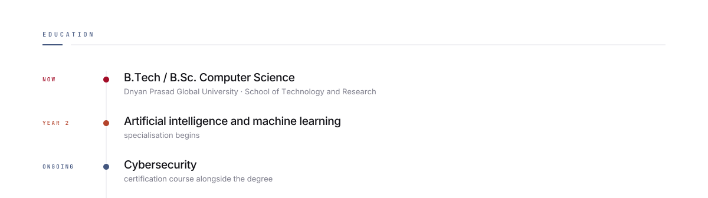
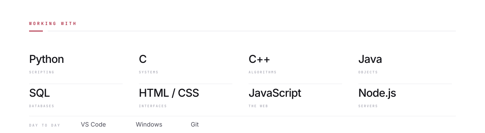
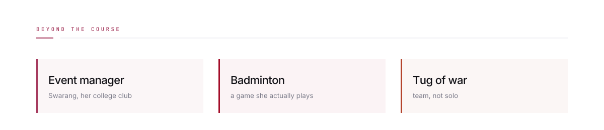
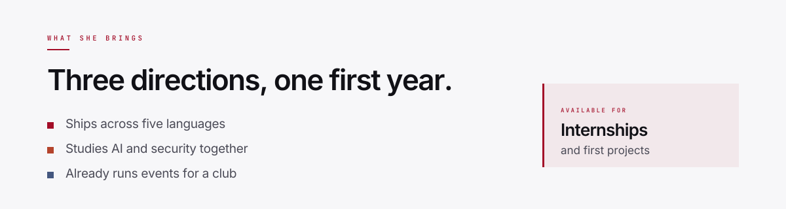

<!--
  Mitali Chincholikar · profile README

  Upload the whole folder flat into a public repo named
  Mitali-Chincholikar, and GitHub renders this on her profile.

  Ten panels. Type is outlined, not requested from the reader's machine, so
  this renders identically on macOS, Windows, Linux and Android. Every panel
  ships as a light/dark pair and is switched with <picture>.

  Nothing here animates.
-->

<picture>
  <source media="(prefers-color-scheme: dark)" srcset="./hero-dark.svg" />
  
</picture>

<picture>
  <source media="(prefers-color-scheme: dark)" srcset="./stats-dark.svg" />
  
</picture>

<picture>
  <source media="(prefers-color-scheme: dark)" srcset="./about-dark.svg" />
  
</picture>

<picture>
  <source media="(prefers-color-scheme: dark)" srcset="./currently-dark.svg" />
  
</picture>

<picture>
  <source media="(prefers-color-scheme: dark)" srcset="./education-dark.svg" />
  
</picture>

<picture>
  <source media="(prefers-color-scheme: dark)" srcset="./stack-dark.svg" />
  
</picture>

<picture>
  <source media="(prefers-color-scheme: dark)" srcset="./beyond-dark.svg" />
  
</picture>

<picture>
  <source media="(prefers-color-scheme: dark)" srcset="./hire-dark.svg" />
  
</picture>

<a href="mailto:chincholikarmitali@gmail.com">
  <picture>
    <source media="(prefers-color-scheme: dark)" srcset="./contact-dark.svg" />
    
  </picture>
</a>

<picture>
  <source media="(prefers-color-scheme: dark)" srcset="./footer-dark.svg" />
  
</picture>
