<!-- ═══════════════════════════════════════════════════════════════════════
     MITALI CHINCHOLIKAR — profile README
     github.com/Mitali-Chincholikar
     -------------------------------------------------------------------
     Every line here comes from her own answers. Nothing invented.

     Assets, all flat in the repo root:
       opening.svg · record.svg · bench.svg · queue.svg
       credits.svg · emblem.svg · divider.svg
     ═══════════════════════════════════════════════════════════════════════ -->

  

 

  

<h1 align="center">MITALI CHINCHOLIKAR</h1>

  <code>CSE · FIRST YEAR</code> &nbsp;·&nbsp;
  <code>AI / ML FROM YEAR 2</code> &nbsp;·&nbsp;
  <code>PUNE, INDIA</code>

  <a href="#-the-line"><b>The Line</b></a> &nbsp;·&nbsp;
  <a href="#-the-queue"><b>The Queue</b></a> &nbsp;·&nbsp;
  <a href="#-the-bench"><b>The Bench</b></a> &nbsp;·&nbsp;
  <a href="mailto:chincholikarmitali@gmail.com"><b>Email</b></a>

 

  

## ⦿ The Line

> **I'm in my first year, and I'm here to turn ambition into reality.**

Nobody hands you permission to build. You just start, and the work either earns
the room or it doesn't. So far it has: two sites built by hand, one college
project that students actually use, and a list of things I'm learning that
gets longer every week, not shorter.

## ⦿ The Queue

  

Not a skill list. A **queue** — in the order I'm actually going to get through it.
Everything on it is something I can't do yet. The day that stops being true, it
comes off this panel.

## ⦿ The Bench

  

**Meditrace** is a student health platform I haven't built yet. I'm not going to
pretend it exists — it's on this page so it stays on my mind.

**AskX** is real. It started as a college project and students use it. It needs
work, and the work is mine to do.

## ⦿ What I Can Actually Do

I can build a page. HTML and CSS I'm fine with — I've made a form-filling site and
a restaurant billing site, both by hand.

JavaScript is where it gets hard. It doesn't click yet. That's not a secret and
it's not a paragraph I'm going to pad with words like *passionate*. It's the next
thing on the queue, and it's why the queue is public.

## ⦿ Contact

  
  
  

 

 

<a href="https://github.com/Mitali-Chincholikar"><b>GitHub</b></a> &nbsp;·&nbsp;
<a href="mailto:chincholikarmitali@gmail.com"><b>Email</b></a> &nbsp;·&nbsp;
<a href="https://instagram.com/uknow.mitali"><b>Instagram</b></a>

  

Pune, Maharashtra · first year · building in public, one queue at a time

