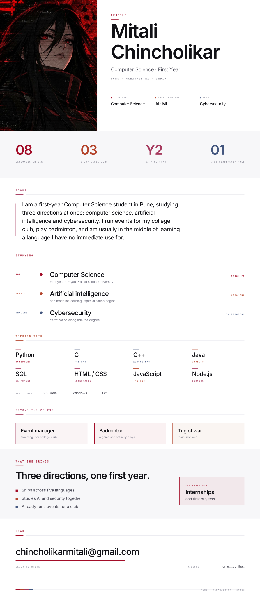

<!--
  Mitali Chincholikar · profile README

  ONE image. The whole page is a single SVG, so GitHub cannot insert its own
  margins between sections and the profile reads as one document rather than
  nine strips.

  Light and dark are separate files, chosen with <picture>.
  Type is outlined and the portrait is embedded as base64, so nothing
  depends on a font, a second file, or the reader's machine.

  Nothing here animates.
-->

<picture>
  <source media="(prefers-color-scheme: dark)" srcset="./page-dark.svg" />
  
</picture>
