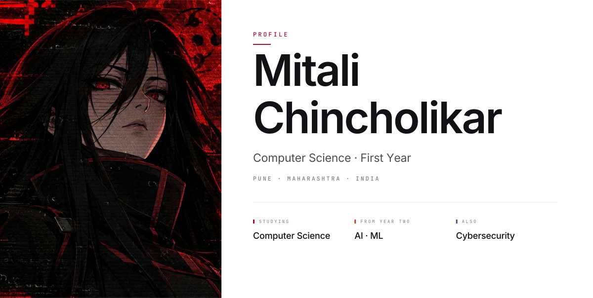

# Setup

Flat files. No build step to run, no dependencies to install, nothing to host.

## What goes up

**Two files plus the avatar.** That is the whole upload.

| File | What it is |
|---|---|
| `README.md` | the profile page |
| `page-light.svg` | the entire page, light theme, 1200 × 2752 |
| `page-dark.svg` | the entire page, dark theme |
| `avatar.png` | 640 × 640, circular, same artwork |

The nine `*-light.svg` / `*-dark.svg` pairs are the source panels the page is
composed from. You do **not** need to upload them — they are here so a single
section can be used on its own, in a CV, a slide, or a repo README.

Thirteen files if you upload the panels too. `portrait.jpg` and `source/` are
build inputs and are not needed on GitHub.

## Why one image instead of nine

GitHub puts its own margin between consecutive images. Nine panels therefore
arrive as nine strips with white gaps, which reads as nine files rather than
one profile. Composing the whole page into a single SVG removes the seams and
lets the section rhythm be designed rather than inherited from the host.

The trade-off: a single 2752px-tall image. That is still well under GitHub's
limits, and it is the only way to control the gaps.

## Upload

1. The repository must be named exactly **`Mitali-Chincholikar`**. That is the
   only thing that makes GitHub render its README on her profile.
2. It must be **public**.
3. Upload every file to the **root**. No subfolders.
4. Set the same `avatar.png` as her GitHub profile picture: Settings → Profile
   picture.

## Why light and dark are separate files

GitHub has two themes and does not tell the image which one the reader chose.
Each panel is therefore drawn twice, and the README picks with `<picture>`:

```html
<picture>
  <source media="(prefers-color-scheme: dark)" srcset="./hero-dark.svg" />
  
</picture>
```

Upload both files of every pair. If one is missing, the other theme shows the
wrong-coloured panel — readable, but wrong.

## Why the portrait is inside the file

GitHub strips external URLs from inside an SVG — a linked
`<image href="portrait.jpg">` renders as nothing. Base64 data URIs are allowed,
so the portrait travels inside the hero. That is why `page-light.svg` is
roughly 800 KB; the artwork accounts for most of it.

## Why the text is outlines

The type is Inter and JetBrains Mono, converted to vector paths by
`../typekit.py`. No font is requested from the reader's machine, so the panels
cannot fall back to Segoe, Roboto or a Linux default and drift out of
alignment. It also means the files render identically in print, in Figma, in
Inkscape, and in any screenshot.

The cost: the text is no longer selectable when the SVG is opened directly.
The `alt` text on every `` carries the full content for screen readers
and for search, so nothing is lost on the page.

## Rebuilding

```sh
python3 ../build_mitali_pro.py
```

That rewrites the panels and both composed pages. Text and colours live in that one file: the two
palettes at the top, and the strings inside each panel function.

## A note on embedding

The portrait is embedded inside the hero SVG as a data URI. GitHub serves SVGs
through an image proxy that will not fetch a second file referenced from
inside one — a linked `<image href="portrait.jpg">` renders as nothing there.
Anything raster has to travel inside the file.

## Check before uploading

```sh
python3 ../check_motion.py
```

There is no animation in this kit, so it should pass trivially. Run it anyway
after any edit.
